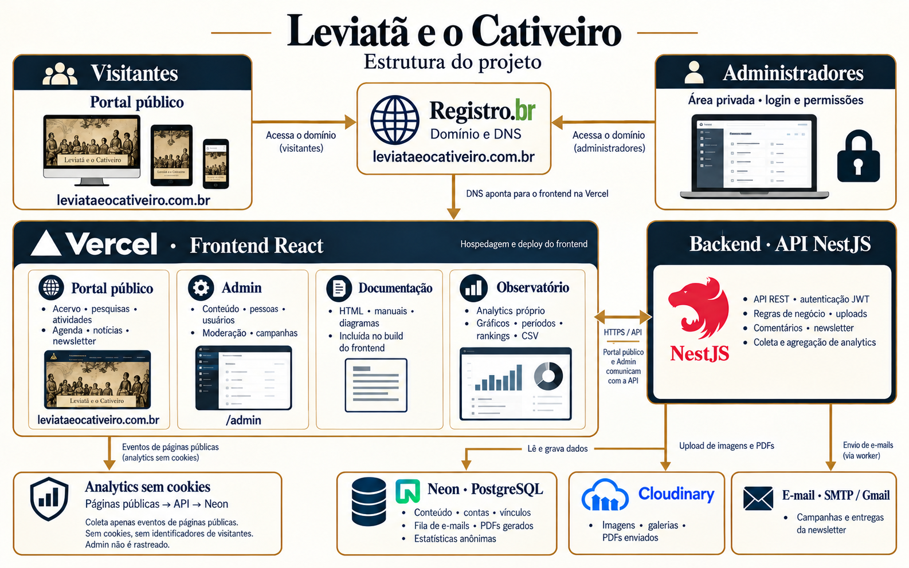

<p align="center">
  
</p>

# Leviatã e o Cativeiro — Frontend

Portal institucional e painel administrativo do **Leviatã e o Cativeiro**, grupo de pesquisa dedicado às relações entre Estado Moderno e escravidão.

A aplicação reúne pesquisadores, produção acadêmica, instrumentos de pesquisa, atividades e notícias. O painel administrativo permite manter esse conteúdo, acompanhar comentários e newsletters, consultar a audiência do portal e acessar a documentação do projeto.

**Domínio do projeto:** [leviataeocativeiro.com.br](https://leviataeocativeiro.com.br)

**Backend:** [leviata-api](https://github.com/RafaelBiatoAzevedo/leviata-api)

## Conteúdo

- [Funcionalidades](#funcionalidades)
- [Tecnologias](#tecnologias)
- [Como executar](#como-executar)
- [Comandos e testes](#comandos-e-testes)
- [Observatório: analytics](#observatório-analytics)
- [Documentação e arquitetura](#documentação-e-arquitetura)
- [Publicação](#publicação)
- [Organização do código](#organização-do-código)

## Funcionalidades

### Portal público

- Apresentação do grupo, pesquisadores e colaboradores internacionais.
- Perfis com foto, vínculo institucional, biografia e links acadêmicos disponíveis.
- Publicações: livros, artigos, dossiês e trabalhos apresentados.
- Instrumentos de pesquisa: catálogos, bancos de dados e planilhas bibliográficas.
- Atividades, pesquisas, júris históricos, encontros, seminários, simpósios e mostras de documentários.
- Agenda, bancas, notícias, vídeos e newsletters.
- Galerias com legendas, leitura de PDFs e comentários sujeitos à moderação.
- Inscrição na newsletter, navegação responsiva e temas claro e escuro.

### Painel administrativo

- Login, renovação de sessão e edição da própria conta.
- Dashboard com indicadores do acervo e atalhos para as áreas de conteúdo.
- Cadastro e edição de conteúdo, imagens, galerias e vínculos entre registros.
- Participantes externos, com dados acadêmicos e de contato opcionais.
- Editor de newsletters, prévia, PDF e acompanhamento dos envios.
- Notificações e moderação de comentários, conforme as permissões da conta.
- Gestão de usuários exclusiva de `SUPER_ADMIN`.
- **Observatório:** estatísticas de acesso ao portal público.
- **Documentação:** manual integrado e botão **Ver estrutura**, com ampliação e download da imagem de arquitetura.

A entrada direta do painel é `/admin`; o login fica em `/admin/login`. O atalho do logo também encaminha para o admin. As permissões efetivas são verificadas pela API.

## Tecnologias

| Tecnologia | Uso |
| --- | --- |
| React 19 + TypeScript 6 | Componentes e tipagem |
| Vite 8 | Desenvolvimento e build |
| React Router 7 | Rotas públicas e administrativas |
| styled-components 6 | Estilos e temas |
| Axios | Integração HTTP com a API |
| React Hook Form + Zod | Formulários e validações |
| Swiper + Framer Motion | Carrosséis e interações |
| React PDF | Leitura de documentos |
| React Easy Crop | Edição e recorte de imagens |
| i18next | Estrutura de internacionalização |

As versões e os comandos disponíveis estão em [package.json](package.json).

## Como executar

### Pré-requisitos

- Node.js **24.x**, utilizado na validação local do projeto.
- npm.
- A [API Leviatã](https://github.com/RafaelBiatoAzevedo/leviata-api) configurada e em execução.

### 1. Instalar

```sh
git clone https://github.com/RafaelBiatoAzevedo/leviata.git
cd leviata
npm ci
```

Este guia usa npm e o `package-lock.json` do repositório.

### 2. Configurar o ambiente

Crie uma configuração local a partir do exemplo:

```sh
cp .env.example .env.local
```

Conteúdo para desenvolvimento:

```dotenv
VITE_API_BASE_URL=http://localhost:3000
VITE_ANALYTICS_ENABLED=false
```

| Variável | Finalidade |
| --- | --- |
| `VITE_API_BASE_URL` | URL da API, incluindo eventual prefixo usado na implantação |
| `VITE_ANALYTICS_ENABLED` | Envio de visualizações públicas ao analytics próprio; habilitado somente com `true` |

O arquivo `.env.local` permite ajustar a instalação sem alterar o `.env` versionado. Variáveis `VITE_` fazem parte do código entregue ao navegador: use apenas configurações públicas, sem segredos de banco, SMTP ou Cloudinary.

### 3. Iniciar

```sh
npm run dev
```

Acesse a URL informada pelo Vite, normalmente `http://localhost:5173`.

Para entrar no admin, use uma conta cadastrada na API. O frontend não cria uma conta administrativa durante a instalação.

## Comandos e testes

| Comando | Finalidade |
| --- | --- |
| `npm run dev` | Servidor de desenvolvimento |
| `npm run build` | Verificação TypeScript e geração de `dist/` |
| `npm run preview` | Prévia local do build |
| `npm run lint` | Análise estática com ESLint |
| `npm run test:admin` | Dashboard, login, menu e responsividade do admin |
| `npm run test:people` | Pessoas e participantes externos |
| `npm run test:portal` | Consumo da API e apresentação do portal |
| `npm run test:navigation` | Navegação e menus |
| `npm run test:theme` | Temas e preferências |
| `npm run test:analytics` | Coleta, filtros, exportação e estados do Observatório |
| `npm run test:newsletter` | Regras de newsletter |
| `npm run test:newsletter-composer` | Editor de newsletters |
| `npm run test:newsletter-delivery` | Acompanhamento dos envios |
| `npm run test:news` | Notícias e galeria do formulário |
| `npm run test:gallery` | Integração de galerias |
| `npm run test:document-viewer` | Leitor de documentos |
| `npm run test:pagination` | Paginação |
| `npm run test:books` | Livros |
| `npm run test:presented-works` | Trabalhos apresentados |
| `npm run test:timeline` | Linha do tempo |
| `npm run test:schedule` | Agenda |
| `npm run test:users` | Usuários |
| `npm run test:thematics` | Temáticas |

Execute os scripts por área, conforme o `package.json`. Os harnesses existentes compartilham mocks quando agrupados de outras formas e podem interferir entre si.

Há também `npm run test:analytics:browser`, uma validação local com Chrome e API mock. Esse teste pressupõe o workspace da API ao lado do frontend, com Puppeteer instalado; o executável do navegador pode ser informado por `CHROME_BIN`.

**Pendências conhecidas:** o lint geral possui quatro erros anteriores em `AdminDataContext.tsx`, `ModalProvider.tsx` e `ToastProvider.tsx`, registrados em [docs/analytics.md](docs/analytics.md). A existência dos scripts não significa que toda verificação geral esteja sem pendências.

## Observatório: analytics

O Observatório usa **analytics próprio**, integrado à API NestJS e ao PostgreSQL. A hospedagem do frontend na Vercel não o transforma em Vercel Web Analytics.

Disponível em `/admin/observatorio`, apresenta visualizações de páginas, evolução temporal, áreas e páginas populares, origens, dispositivos, navegadores e exportação CSV.

A instrumentação:

- Conta navegações visíveis entre páginas públicas da SPA.
- Exclui a área administrativa e evita duplicações por rerenderização.
- Agrupa rotas dinâmicas sem enviar os identificadores dos conteúdos.
- Respeita DNT, Global Privacy Control e a preferência de opt-out no rodapé.
- Não cria cookies de analytics nem identificadores de visitantes ou sessões.

Sessões, visitantes únicos, países e presença online não são medidos. A coleta começa após a ativação, sem histórico retroativo.

Para habilitar, configure a migration, as origens e `ANALYTICS_ENABLED=true` na API; depois publique o frontend com `VITE_ANALYTICS_ENABLED=true`. O painel tem cache de até cinco minutos e informa configuração pendente ou indisponibilidade.

Guia completo: [configuração e operação](docs/analytics.md) · [decisão de arquitetura](docs/analytics-decision.md).

## Documentação e arquitetura



A imagem apresenta a organização do projeto; a disponibilidade das integrações depende da configuração de cada ambiente.

No admin, `/admin/documentacao` reúne o manual HTML e a visualização da estrutura. O conjunto está em [public/documentacao](public/documentacao) e é copiado automaticamente para `dist/documentacao` durante o build.

- [Guia inicial da documentação](public/documentacao/LEIA-ME_DOCUMENTACAO_LEVIATA.md)
- [Manual completo em HTML](public/documentacao/LEVIATA_DOCUMENTACAO_COMPLETA.html)
- [Tecnologias e arquitetura](public/documentacao/LEVIATA_01_TECNOLOGIAS_E_ARQUITETURA.md)
- [Manual funcional](public/documentacao/LEVIATA_02_MANUAL_FUNCIONAL.md)
- [API e banco de dados](public/documentacao/LEVIATA_03_API_E_BANCO_DE_DADOS.md)
- [Operação e manutenção](public/documentacao/LEVIATA_04_OPERACAO_E_MANUTENCAO.md)
- [Cobertura e rastreabilidade](public/documentacao/LEVIATA_05_COBERTURA_E_RASTREABILIDADE.md)

O HTML pode ser baixado pelo GitHub e aberto no navegador. O manual extenso representa a edição de 27/10/2026; os guias em [docs/](docs/) documentam evoluções posteriores.

Os arquivos em `public/` são estáticos e acessíveis por URL direta. O login protege a rota do leitor no admin, mas não torna privados os arquivos publicados nessa pasta.

## Publicação

O build produz um frontend estático em `dist/`. A API é publicada e configurada separadamente.

### Vercel

1. Importe este repositório e selecione o preset **Vite**.
2. Use `npm run build` como comando de build e `dist` como diretório de saída.
3. Configure `VITE_API_BASE_URL` com a URL HTTPS da API.
4. Defina `VITE_ANALYTICS_ENABLED` conforme a ativação do backend.
5. Faça um novo deploy após alterar variáveis incorporadas ao build.
6. Confira a abertura direta e a atualização de rotas como `/grupo/pesquisadores` e `/admin/documentacao`.

Para o fallback de uma SPA na Vercel, a configuração documentada pode ser adicionada a um `vercel.json` na raiz:

```json
{
  "rewrites": [
    { "source": "/(.*)", "destination": "/index.html" }
  ]
}
```

Esse arquivo ainda não integra o repositório. Ao configurar o roteamento, valide também a entrega direta do HTML, da imagem e dos anexos em `/documentacao/`. O arquivo `public/_redirects` atende provedores que reconhecem esse formato e não substitui a configuração da Vercel.

Referências oficiais: [Vite na Vercel](https://vercel.com/docs/frameworks/frontend/vite) · [publicação de sites Vite](https://vite.dev/guide/static-deploy.html).

`npm run preview` serve para conferir o build localmente; a publicação deve usar uma hospedagem de arquivos estáticos.

## Organização do código

```text
src/
├── admin/           # Painel, formulários, rotas e serviços administrativos
├── analytics/       # Instrumentação pública e preferência de privacidade
├── components/      # Componentes compartilhados do portal
├── contexts/        # Autenticação e temas
├── hooks/           # Hooks compartilhados
├── layouts/         # Layouts públicos
├── pages/           # Páginas públicas
├── routes/          # Composição das rotas
├── services/        # Cliente HTTP e serviços públicos
├── shared/          # Modal, toast e recursos compartilhados
├── styles/          # Temas e estilos globais
└── utils/           # Formatação e regras auxiliares
public/documentacao/ # Documentos e imagem incluídos na publicação
docs/                # Guias de evolução e operação
test/                # Testes por área funcional
```

## Licença

Este repositório não contém um arquivo `LICENSE` e está marcado como `private` no `package.json`. As dependências mantêm suas próprias licenças.
