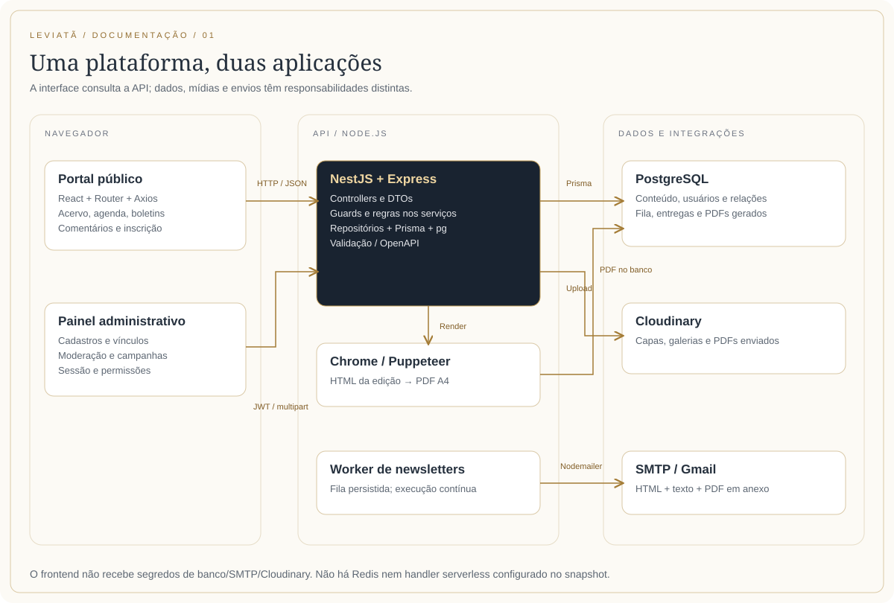

# Tecnologias e arquitetura

## 1. O que este sistema resolve

O Leviatã e o Cativeiro reúne um portal público de pesquisa histórica e um painel administrativo para manter seu acervo. O projeto tem duas aplicações: `leviata`, responsável pela interface, e `leviata-api`, responsável pelas regras, persistência, autenticação, arquivos e envios. O recorte institucional é Estado Moderno e escravidão, com pesquisas que conectam Brasil e Portugal.

Esta documentação descreve o código local em **27 de outubro de 2026**, incluindo alterações ainda sem commit. Não é uma declaração sobre o que está publicado em um servidor. Os dados privados dos bancos, tokens e valores dos arquivos `.env` não foram incorporados.

**Como interpretar “plugins”:** neste projeto são bibliotecas npm, plugins de compilação/análise e integrações externas. Não foi encontrada uma aplicação WordPress nem plugins de WordPress na implementação atual. Os manifestos têm **83 dependências diretas**, entre execução e desenvolvimento. As dependências transitivas são resolvidas pelos arquivos de lock; não equivalem a 83 serviços externos.

## 2. Visão da arquitetura

O navegador executa uma SPA React. O React Router seleciona a tela e o Axios chama a API REST. O NestJS organiza o backend em módulos, controllers, serviços e repositórios. O Prisma traduz as operações de dados para PostgreSQL por meio de `@prisma/adapter-pg` e `pg`.

Fotos, capas e PDFs enviados são tratados pelo Cloudinary. Os PDFs de newsletter são uma exceção importante: são gerados com Chrome/Puppeteer e guardados em campos binários no PostgreSQL. O envio de boletins usa Nodemailer/SMTP; a fila durável usa o próprio banco, sem Redis.

| Camada | Responsabilidade | Fonte principal |
| --- | --- | --- |
| Interface pública | Leitura do acervo, notícias, agenda, comentários, inscrição e leitura dos boletins | `leviata/src/pages`, `leviata/src/components` |
| Administração | Login, cadastros, vínculos, arquivos, moderação, usuários e campanhas | `leviata/src/admin` |
| Estado compartilhado | Sessão, tema, notificações, dados auxiliares, modais e avisos | `contexts`, `shared`, hooks |
| Transporte | JSON, query strings, multipart, JWT Bearer e download binário | Serviços Axios e controllers Nest |
| Regras | Validação de vínculos, moderação, publicação, geração de documentos e envio | Serviços dos módulos da API |
| Persistência | Entidades, relações, filtros, paginação, transações e exclusão lógica | Repositórios e `prisma/schema.prisma` |
| Serviços externos | Mídias Cloudinary, SMTP Gmail e URLs de vídeos/documentos | `cloudinary`, `mail`, links dos registros |

O estado de uma interação permanece no React; não há Redux nesta implementação. O banco de negócio fica exclusivamente na API. O frontend não se conecta diretamente ao PostgreSQL e não recebe credenciais do Cloudinary ou do SMTP.

## 3. Frontend: decisões e organização

### 3.1 React, TypeScript e Vite

React permite compor cards, formulários, leitores, menus e telas a partir de componentes. TypeScript descreve contratos entre essas partes e reduz erros de integração. Vite fornece o servidor de desenvolvimento e monta os arquivos estáticos de produção. O build executa `tsc -b` antes de `vite build`.

O plugin efetivamente configurado é `@vitejs/plugin-react`, em `vite.config.ts`. A alternativa SWC citada pelo README de template **não está configurada**. Também não foi encontrado React Compiler habilitado. O projeto é uma SPA com renderização no navegador; não há Next.js nem renderização de páginas no servidor implementada.

Fontes primárias: [React](https://react.dev/learn), [Vite](https://vite.dev/guide/) e os arquivos locais `src/main.tsx`, `src/App.tsx`, `vite.config.ts`.

### 3.2 Rotas, providers e ciclo de dados

`BrowserRouter` envolve a aplicação. `App.tsx` compõe `AuthProvider`, `AppearanceProvider`, `ModalProvider` e `ToastProvider`. `GlobalStyle` aplica a base visual. A árvore de rotas separa `MainLayout`, `/admin/login` e as rotas protegidas pelo `PrivateRoute`.

O painel acrescenta `AdminDataProvider`, para países, instituições e títulos acadêmicos, e `NotificationsProvider`, para os contadores compartilhados. Uma consulta pública usa `usePublicList` ou `usePublicRecord`; consultas antigas são abortadas ao mudar de rota/filtro. As listas públicas carregam páginas de até 100 registros por vez até terminar a coleção. As listas administrativas usam paginação no servidor, com total filtrado e normalmente 15 linhas na primeira configuração da interface.

O Axios centraliza `baseURL` em `VITE_API_BASE_URL`. Um interceptor tenta renovar a sessão uma vez diante de 401, rotaciona os tokens e repete a requisição. Se a renovação falhar, limpa apenas a autenticação e encaminha rotas administrativas ao login. A rota de renovação e o logout não entram nessa repetição. A implementação atual não tem uma fila compartilhada de renovações concorrentes; esse comportamento merece atenção em evoluções do fluxo.

### 3.3 Formulários, validação e adaptação de contratos

React Hook Form controla os formulários; Zod descreve a validação no navegador e `@hookform/resolvers` conecta ambos. Os mappers convertem respostas em valores editáveis e preparam os payloads. Os serviços decidem quando usar JSON ou `FormData`. UUIDs de listas de pessoas e o `contentData` da newsletter podem viajar como JSON dentro de campos multipart.

A validação do navegador melhora a experiência, mas a API continua sendo a autoridade. O uso de `?` em um tipo TypeScript, sozinho, não torna um campo opcional na validação HTTP. Os contratos da API e as fontes das validações do front estão reproduzidos nos volumes de referência.

### 3.4 Sistema visual e acessibilidade

Styled-components mantém estilos próximos aos componentes e recebe o tema compartilhado. A identidade usa dourado, fundos claros ou grafite, Inter nos textos e Cormorant Garamond nos títulos. As fontes Fontsource são importadas no código; não é necessário carregar Google Fonts em tempo de navegação.

O claro é o padrão, mesmo se o sistema operacional estiver em modo escuro. A preferência explícita fica em `portfolio-theme`, sincroniza entre abas e é restaurada cedo no HTML. Imagens e documentos não são invertidos. A interface usa foco visível, labels, estados anunciados, modais isolados, navegação por teclado e movimento reduzido. Esses mecanismos não representam uma certificação integral de acessibilidade; ajustes visuais ainda devem ser conferidos nos navegadores usados pela equipe.

Referência da biblioteca: [styled-components](https://styled-components.com/docs). Fontes locais: `src/styles/themes.ts`, `src/styles/GlobalStyle.ts`, `src/styles/darkThemeVariables.ts`, `src/contexts/ThemeContext.tsx`.

### 3.5 Carrosséis, arquivos e leitores

Swiper fornece navegação, paginação e adaptação dos carrosséis de publicações, notícias, galerias e comentários. O editor de imagens usa React Easy Crop, com processamento em canvas no navegador. React PDF usa PDF.js e um worker empacotado pelo Vite para ler documentos. O leitor de HTML de newsletters usa iframe isolado para evitar que o código da edição altere os estilos do portal/admin.

`framer-motion` está instalado, mas o inventário não encontrou importação dele no código-fonte atual. As transições visuais descritas aqui não devem ser atribuídas automaticamente a essa biblioteca. A infraestrutura i18next/react-i18next inicializa recursos em português e inglês e lê `portfolio-language`, mas a interface contém muitos textos literais em português: **não existe cobertura completa de tradução nem seletor de idioma ativo identificado no menu atual**.

## 4. API: decisões e organização

### 4.1 Módulos, controllers, serviços e repositórios

NestJS fornece organização modular, injeção de dependências, decorators e integração HTTP com Express. Um controller recebe a requisição, os DTOs transformam/validam entradas, o serviço aplica regras, o repositório consulta o Prisma e o banco garante relações/índices. Essa separação facilita localizar um comportamento e substituir Prisma, SMTP ou Cloudinary por implementações simuladas nos testes.

Existem 29 classes de módulo e 31 controllers no inventário. Alguns módulos são infraestrutura: Prisma, autenticação, upload, Cloudinary, imagens e geração de PDF. Outros correspondem ao domínio: pessoas, publicações, atividades, pesquisas, notícias, agenda, newsletters, notificações e usuários.

Referência: [NestJS](https://docs.nestjs.com/). Fonte de composição: `leviata-api/src/app.module.ts`.

### 4.2 DTOs, validação e documentação HTTP

`ValidationPipe` usa `whitelist: true`, `forbidNonWhitelisted: true` e `transform: true`. Propriedades inesperadas podem causar 400; os controllers não aceitam campos arbitrários apenas porque o banco tem uma coluna correspondente. Class-validator valida tipos, tamanho, enum, URLs e UUIDs. Class-transformer converte datas, números e listas multipart, além de executar normalizações específicas.

Swagger/OpenAPI é montado a partir dos decorators. `/docs` abre a interface e `/docs-json` disponibiliza o contrato gerado. A raiz `/` redireciona para `/docs`. O catálogo deste pacote registra também operações excluídas do Swagger, como o redirecionamento, e distingue acesso real por guards da simples presença de `ApiBearerAuth`.

Não há um guard JWT global registrado por `APP_GUARD`: os decorators dos controllers/métodos são determinantes. `@Public()` dispensa `JwtAuthGuard` onde ele está aplicado; guards adicionais continuam executando. Por exemplo, envio de comentário é público e continua sujeito a `CommentThrottleGuard`.

### 4.3 Banco, transações e arquivos

Prisma 7.8 descreve 27 modelos e 12 enums. Há 38 diretórios de migration. PostgreSQL mantém os dados relacionais, a fila de e-mail, o histórico e os PDFs gerados. A conexão `pg` é configurada em UTC e seu pool é encerrado com a aplicação. Transações são usadas, entre outros pontos, para proteger o último superadmin, criar comentário/notificação, aplicar moderação e registrar aceitação SMTP/entrega.

O schema diferencia `Search` (modelo que representa pesquisas) de pesquisa textual nas listagens. `Jury` fica no diretório `src/juris`, mas a rota é `/juries`. `researchInstruments` preserva camelCase na API, enquanto o painel usa `/admin/instrumentos-pesquisa`. Essas diferenças são contratos existentes, não erros de digitação desta documentação.

A maioria dos registros editoriais usa exclusão lógica por `deletedAt`/`deletedById`. A recusa de comentário é exclusão física. Remover mídia pode excluir o arquivo do Cloudinary; apagar um vínculo de vídeo de temática não apaga o vídeo no catálogo. Não existe uma lixeira/restauração genérica exposta no painel.

Referência: [Prisma ORM](https://www.prisma.io/docs/orm). O portal atual da documentação do fornecedor pode mostrar uma versão mais recente; a versão aqui descrita é a instalada no projeto, não a mais recente disponível na internet.

### 4.4 Integrações e seus motivos

| Integração | Por que está no projeto | O que permanece local |
| --- | --- | --- |
| Cloudinary | Armazenar e servir capas, fotos e documentos enviados, com identificadores de mídia para manutenção | URLs, `publicId`, legendas e vínculos no PostgreSQL |
| Gmail/SMTP + Nodemailer | Enviar newsletters com HTML, texto alternativo, anexo PDF e cabeçalhos de descadastro | Elegibilidade, fila, tentativas e histórico no banco |
| Chrome/Puppeteer | Converter o mesmo HTML da newsletter em um documento PDF A4 | HTML, hash, data e PDF persistidos pela API |
| URLs de vídeos | Incorporar conteúdos de vídeo já publicados em plataformas externas | Título, descrição, pessoas e URL de incorporação |
| Serviços PostgreSQL compatíveis | Possibilitar banco local ou hospedado, inclusive um serviço como Neon, via `DATABASE_URL` | Modelos e consultas continuam sendo Prisma/PostgreSQL |

Neon, Vercel, GitHub e Registro.br aparecem como opções de implantação no material histórico da pasta, mas não foram consultados nem confirmados como ambientes ativos. O pacote não contém prova de um deploy em produção nem configuração completa para esses provedores.

Fontes dos fornecedores: [Cloudinary Node SDK](https://cloudinary.com/documentation/node_integration), [Nodemailer](https://nodemailer.com/), [Puppeteer PDF](https://pptr.dev/guides/pdf-generation).

## 5. Infraestrutura nativa e dependências transitivas relevantes

| Tecnologia | Como participa da implementação |
| --- | --- |
| Express 5.2.1 observado | Servidor HTTP consumido pelo adaptador Nest; requests, responses, body parser, CORS e multipart. Não é uma terceira aplicação independente. |
| PDF.js / `pdfjs-dist` 5.4.296 observado | Motor de PDF transitivo de React PDF; o front referencia explicitamente seu worker. Não confundir com Puppeteer, que gera PDF no servidor. |
| `jsonwebtoken` 9.0.3 observado | Biblioteca transitiva do ecossistema JWT; a aplicação utiliza a camada `@nestjs/jwt` para assinar/verificar tokens. |
| Canvas, File, Blob e Object URL | Recorte, rotação, arquivos locais, prévias e downloads no navegador; URLs temporárias precisam ser liberadas. |
| ResizeObserver e Fullscreen API | Medição da área do leitor e ampliação do documento quando suportada. |
| Intl / Date e fuso horário | Formatação de datas, períodos, agenda e decisão de publicação por dia no Brasil. |
| localStorage e evento storage | Sessão, tema e idioma; sincronização de aparência entre abas. Não são cookies HttpOnly. |
| AbortController | Cancelamento de consultas que perderam validade por troca de tela/filtro. |
| Node crypto | UUIDs, hashes de origem de PDF, assinatura e verificação de links de descadastro. |
| Node DNS, HTTP/HTTPS e net | Busca controlada dos ativos de PDF, validação de endereços e fixação do DNS. |
| Node stream e Buffer | Upload por stream para Cloudinary e transporte de arquivos/anexos binários. |
| Node fs/path e temporizadores | Localização de executáveis/cache e processamento periódico da fila no processo da API. |
| PostgreSQL: transações, índices e reservas | Integridade de vínculos, prevenção de campanhas repetidas, elegibilidade e histórico consistente. |

Esses mecanismos ajudam a explicar o sistema inteiro sem atribuir APIs nativas a “plugins” inexistentes. As dependências transitivas completas dos três locks também estão catalogadas no inventário JSON. Os números de versão desta tabela são observados localmente, não uma recomendação para atualizar pacotes isoladamente.

## 6. Dependências diretas: versões, finalidade e evidências

As tabelas a seguir foram geradas dos dois `package.json` e das versões presentes em `node_modules`. **Faixa declarada** é o que o manifesto permite; **versão observada** é o que estava instalado durante a documentação. Uma instalação futura pode resolver outra versão se o lock não for preservado.

O motivo de uso é explicado para cada pacote. “Infraestrutura” significa que o pacote é acionado pelo framework, compilador ou uma ferramenta, mesmo sem importação direta em `src`. “Instalado sem uso direto identificado” é distinto de uma funcionalidade implementada.

### leviata

#### Execução

| Pacote | Faixa declarada | Versão observada | Papel e motivo no projeto | Evidência |
| --- | --- | --- | --- | --- |
| `@fontsource/cormorant-garamond` | `^5.2.11` | `5.2.11` | Fornece os arquivos locais da fonte serifada dos títulos; preserva a identidade editorial sem depender de Google Fonts em tempo de navegação. | [leviata/src/styles/GlobalStyle.ts](<leviata/src/styles/GlobalStyle.ts>) |
| `@fontsource/inter` | `^5.2.8` | `5.2.8` | Fornece localmente a fonte de textos, botões, menus e formulários; mantém leitura consistente entre as telas. | [leviata/src/styles/GlobalStyle.ts](<leviata/src/styles/GlobalStyle.ts>) |
| `@hookform/resolvers` | `^5.4.0` | `5.4.0` | Liga os schemas Zod ao React Hook Form, devolvendo erros por campo sem duplicar o mecanismo de validação. | [leviata/src/admin/pages/AdminArticles/Form/index.tsx](<leviata/src/admin/pages/AdminArticles/Form/index.tsx>) |
| `axios` | `^1.18.1` | `1.18.1` | Cliente HTTP compartilhado: API base, JSON/multipart, sinais de cancelamento, downloads e tratamento/renovação de sessão por interceptors. | [leviata/src/admin/hooks/useAdminList.ts](<leviata/src/admin/hooks/useAdminList.ts>) |
| `framer-motion` | `^12.39.0` | `12.39.0` | Biblioteca de animação declarada no manifesto. Não foram identificados imports no código-fonte atual; não é responsável comprovada por uma funcionalidade ativa. | [Manifesto / ferramenta](<leviata/package.json>) |
| `i18next` | `^26.2.0` | `26.2.0` | Inicializa recursos de idioma e preferência salva. A infraestrutura está presente, mas a tradução integral da interface não está implementada. | [leviata/src/i18n/index.ts](<leviata/src/i18n/index.ts>) |
| `react` | `^19.2.6` | `19.2.6` | Componentes, estados, efeitos, contextos e interação das telas públicas e administrativas. | [leviata/src/admin/components/AdminBadge/index.tsx](<leviata/src/admin/components/AdminBadge/index.tsx>) |
| `react-dom` | `^19.2.6` | `19.2.6` | Monta React no elemento root; createPortal também permite ao editor de imagem renderizar um diálogo fora da hierarquia visual do formulário. | [leviata/src/admin/components/AdminImageEditor/index.tsx](<leviata/src/admin/components/AdminImageEditor/index.tsx>) |
| `react-easy-crop` | `^6.2.4` | `6.2.4` | Interface de enquadramento, zoom e recorte antes de aplicar a imagem; combina-se com canvas para produzir o arquivo final. | [leviata/src/admin/components/AdminImageEditor/canvas.ts](<leviata/src/admin/components/AdminImageEditor/canvas.ts>) |
| `react-hook-form` | `^7.82.0` | `7.82.0` | Controle dos formulários e estados de validação/envio; evita tratar cada campo manualmente nos cadastros. | [leviata/src/admin/components/NewsletterComposer/index.tsx](<leviata/src/admin/components/NewsletterComposer/index.tsx>) |
| `react-i18next` | `^17.0.8` | `17.0.8` | Integra o motor i18next ao React; inicialização existente, sem adoção completa de traduções nas telas atuais. | [leviata/src/i18n/index.ts](<leviata/src/i18n/index.ts>) |
| `react-icons` | `^5.6.0` | `5.6.0` | Fornece os ícones de navegação, ações, status, redes e arquivos por componentes SVG reutilizáveis. | [leviata/src/admin/components/AdminError/index.tsx](<leviata/src/admin/components/AdminError/index.tsx>) |
| `react-pdf` | `^10.4.1` | `10.4.1` | Renderiza páginas PDF no portal usando PDF.js, permitindo ajuste ao espaço, paginação e camada de texto/links. | [leviata/src/components/DocumentViewer/index.tsx](<leviata/src/components/DocumentViewer/index.tsx>) |
| `react-router-dom` | `^7.15.1` | `7.15.1` | Define rotas, layouts, parâmetros, links, abas por query e proteção/redirecionamento de navegação. | [leviata/src/admin/components/AdminFormActions/index.tsx](<leviata/src/admin/components/AdminFormActions/index.tsx>) |
| `styled-components` | `^6.4.1` | `6.4.1` | Estilos de componentes, responsividade, estados e temas compartilhados via ThemeProvider. | [leviata/src/admin/components/AdminBadge/styles.ts](<leviata/src/admin/components/AdminBadge/styles.ts>) |
| `swiper` | `^12.1.4` | `12.1.4` | Carrosséis de publicações, notícias, fotos e comentários com navegação, paginação e breakpoints. | [leviata/src/components/Comments/index.tsx](<leviata/src/components/Comments/index.tsx>) |
| `zod` | `^4.4.3` | `4.4.3` | Valida campos e regras cruzadas dos formulários no navegador antes de chamar a API. | [leviata/src/admin/pages/AdminPeople/Form/index.tsx](<leviata/src/admin/pages/AdminPeople/Form/index.tsx>) |

#### Desenvolvimento e tipagens

| Pacote | Faixa declarada | Versão observada | Papel e motivo no projeto | Evidência |
| --- | --- | --- | --- | --- |
| `@eslint/js` | `^10.0.1` | `10.0.1` | Regras base JavaScript do ESLint, importadas pela configuração de análise do respectivo projeto. | [Manifesto / ferramenta](<leviata/package.json>) |
| `@types/node` | `^24.12.3` | `24.12.4` | Tipagens de desenvolvimento para APIs do Node em ferramentas/testes e backend. Não é um serviço externo nem código de negócio separado. | [Manifesto / ferramenta](<leviata/package.json>) |
| `@types/react` | `^19.2.14` | `19.2.14` | Tipagens de desenvolvimento para contratos JSX, componentes e hooks React. Não é um serviço externo nem código de negócio separado. | [Manifesto / ferramenta](<leviata/package.json>) |
| `@types/react-dom` | `^19.2.3` | `19.2.3` | Tipagens de desenvolvimento para root, portal e renderização React DOM. Não é um serviço externo nem código de negócio separado. | [Manifesto / ferramenta](<leviata/package.json>) |
| `@types/styled-components` | `^5.1.36` | `5.1.36` | Pacote de tipos declarado na linha 5. A biblioteca styled-components 6 instalada já fornece tipos próprios; a necessidade adicional deste pacote não foi demonstrada. | [Manifesto / ferramenta](<leviata/package.json>) |
| `@vitejs/plugin-react` | `^6.0.1` | `6.0.2` | Único plugin configurado no Vite: integração React, transformação JSX e atualização do desenvolvimento. | [Manifesto / ferramenta](<leviata/package.json>) |
| `eslint` | `^10.3.0` | `10.4.0` | Analisa padrões, erros e regras do código. O script da API acrescenta --fix, portanto pode alterar fontes. | [Manifesto / ferramenta](<leviata/package.json>) |
| `eslint-plugin-react-hooks` | `^7.1.1` | `7.1.1` | Verifica uso e dependências de hooks para reduzir estados/efeitos incorretos nos componentes. | [Manifesto / ferramenta](<leviata/package.json>) |
| `eslint-plugin-react-refresh` | `^0.5.2` | `0.5.2` | Verifica padrões compatíveis com a atualização rápida de módulos/componentes no desenvolvimento. | [Manifesto / ferramenta](<leviata/package.json>) |
| `globals` | `^17.6.0` | `17.6.0` | Declara conjuntos de nomes globais conhecidos pelo ESLint: navegador no front, Node/Jest na API. | [Manifesto / ferramenta](<leviata/package.json>) |
| `typescript` | `~6.0.2` | `6.0.3` | Compilação e checagem de tipos. O front usa versão 6 e a API versão 5; não compartilham obrigatoriamente a mesma instalação. | [Manifesto / ferramenta](<leviata/package.json>) |
| `typescript-eslint` | `^8.59.2` | `8.59.4` | Conecta parser e regras TypeScript ao ESLint; a API usa análise com informação de tipos. | [Manifesto / ferramenta](<leviata/package.json>) |
| `vite` | `^8.0.12` | `8.0.13` | Servidor de desenvolvimento e empacotamento dos assets estáticos do frontend; também resolve o worker PDF.js. | [Manifesto / ferramenta](<leviata/package.json>) |

### leviata-api

#### Execução

| Pacote | Faixa declarada | Versão observada | Papel e motivo no projeto | Evidência |
| --- | --- | --- | --- | --- |
| `@nestjs/common` | `^11.0.1` | `11.1.24` | Decorators, injeção, pipes, exceções, guards e contratos de ciclo de vida usados em toda a API. | [leviata-api/src/academic-titles/academic-titles.controller.ts](<leviata-api/src/academic-titles/academic-titles.controller.ts>) |
| `@nestjs/config` | `^4.0.4` | `4.0.4` | Carrega .env e injeta configuração de JWT, SMTP e demais parâmetros no backend. | [leviata-api/src/app.module.ts](<leviata-api/src/app.module.ts>) |
| `@nestjs/core` | `^11.0.1` | `11.1.24` | Cria a aplicação Nest, coordena módulos e disponibiliza Reflector para metadados de autorização. | [leviata-api/src/auth/jwt-auth.guard.ts](<leviata-api/src/auth/jwt-auth.guard.ts>) |
| `@nestjs/jwt` | `^11.0.2` | `11.0.2` | Assina/verifica access e refresh tokens no fluxo de autenticação. | [leviata-api/src/auth/auth.module.ts](<leviata-api/src/auth/auth.module.ts>) |
| `@nestjs/passport` | `^11.0.5` | `11.0.5` | Integra estratégias Passport aos guards JWT do Nest. | [leviata-api/src/auth/jwt-auth.guard.ts](<leviata-api/src/auth/jwt-auth.guard.ts>) |
| `@nestjs/platform-express` | `^11.1.28` | `11.1.28` | Adaptador HTTP Express e interceptors de arquivo multipart integrados ao Nest. | [leviata-api/src/articles/articles.controller.ts](<leviata-api/src/articles/articles.controller.ts>) |
| `@nestjs/swagger` | `^11.4.4` | `11.4.4` | Gera OpenAPI e Swagger UI a partir de controllers e DTOs; inclui tipos, operações e metadados Bearer. | [leviata-api/src/academic-titles/academic-titles.controller.ts](<leviata-api/src/academic-titles/academic-titles.controller.ts>) |
| `@prisma/adapter-pg` | `^7.8.0` | `7.8.0` | Conecta Prisma 7 ao pool PostgreSQL fornecido pelo driver pg, com controle de ciclo de vida. | [leviata-api/src/prisma/prisma.service.ts](<leviata-api/src/prisma/prisma.service.ts>) |
| `@prisma/client` | `^7.8.0` | `7.8.0` | Cliente gerado do schema: consultas tipadas, enums, relações, transações e operações de persistência. | [leviata-api/src/articles/DTOs/article-query.dto.ts](<leviata-api/src/articles/DTOs/article-query.dto.ts>) |
| `bcrypt` | `^6.0.0` | `6.0.0` | Compara/gera hashes de senhas e de refresh tokens; não guarda esses valores em texto simples no modelo de acesso. | [leviata-api/src/auth/auth.service.spec.ts](<leviata-api/src/auth/auth.service.spec.ts>) |
| `class-transformer` | `^0.5.1` | `0.5.1` | Normaliza e converte payloads: números, datas, arrays multipart e estrutura aninhada de newsletter. | [leviata-api/src/articles/DTOs/article-query.dto.ts](<leviata-api/src/articles/DTOs/article-query.dto.ts>) |
| `class-validator` | `^0.15.1` | `0.15.1` | Validação autoritativa da API: tipos, comprimento, enum, UUID, URL e condições por campo. | [leviata-api/src/articles/DTOs/article-query.dto.ts](<leviata-api/src/articles/DTOs/article-query.dto.ts>) |
| `cloudinary` | `^2.10.0` | `2.10.0` | SDK do provedor de mídia para upload por stream, renomeação, metadados e exclusão de arquivos. | [leviata-api/src/cloudinary/cloudinary.service.ts](<leviata-api/src/cloudinary/cloudinary.service.ts>) |
| `dotenv` | `^17.4.2` | `17.4.2` | Lê variáveis de ambiente nos comandos Prisma/configuração e seed; o Nest também usa ConfigModule no runtime. | [Manifesto / ferramenta](<leviata-api/package.json>) |
| `html-to-text` | `^10.0.1` | `10.0.1` | Gera alternativa textual do corpo HTML do e-mail, útil para clientes que não exibem HTML. | [leviata-api/src/mail/mail.template.ts](<leviata-api/src/mail/mail.template.ts>) |
| `multer` | `^2.2.0` | `2.2.0` | Recebe multipart com arquivos em memória e limites configurados; tipos Express.Multer.File são utilizados nos contratos internos. | [leviata-api/src/images/gallery-file.ts](<leviata-api/src/images/gallery-file.ts>) |
| `nodemailer` | `^10.2.1` | `10.2.1` | Transporte SMTP com OAuth2 ou senha de aplicativo, HTML/texto, cabeçalhos de descadastro e anexo PDF. | [leviata-api/src/mail/mail.service.ts](<leviata-api/src/mail/mail.service.ts>) |
| `passport` | `^0.7.0` | `0.7.0` | Infraestrutura de autenticação consumida pelo adaptador Nest/Passport; não exige importação direta em cada controller. | [Manifesto / ferramenta](<leviata-api/package.json>) |
| `passport-jwt` | `^4.0.1` | `4.0.1` | Extrai/valida JWT Bearer e executa a estratégia que confere usuário ativo e versão de sessão. | [leviata-api/src/auth/jwt.strategy.ts](<leviata-api/src/auth/jwt.strategy.ts>) |
| `pg` | `^8.21.0` | `8.21.0` | Driver/pool PostgreSQL usado pelo adapter Prisma e pelos seeds; não é outro banco independente. | [leviata-api/src/prisma/prisma.service.ts](<leviata-api/src/prisma/prisma.service.ts>) |
| `puppeteer` | `25.16.0` | `25.16.0` | Carrega Chrome para gerar o PDF do mesmo HTML editorial; importado dinamicamente no serviço de documentos. | [leviata-api/src/newsletter/pdf/newsletter-pdf.service.ts](<leviata-api/src/newsletter/pdf/newsletter-pdf.service.ts>) |
| `reflect-metadata` | `^0.2.2` | `0.2.2` | Suporte a metadados de decorators usados pelo ecossistema Nest/validação; também aparece em testes de DTO. | [leviata-api/src/books/DTOs/create-book.dto.spec.ts](<leviata-api/src/books/DTOs/create-book.dto.spec.ts>) |
| `rxjs` | `^7.8.1` | `7.8.2` | Infraestrutura de Observables exigida pelo ecossistema Nest; não foram identificados fluxos reativos próprios de negócio. | [Manifesto / ferramenta](<leviata-api/package.json>) |
| `swagger-ui-express` | `^5.0.1` | `5.0.1` | Serve a interface visual do OpenAPI utilizada pelo módulo Swagger do Nest. | [Manifesto / ferramenta](<leviata-api/package.json>) |

#### Desenvolvimento e tipagens

| Pacote | Faixa declarada | Versão observada | Papel e motivo no projeto | Evidência |
| --- | --- | --- | --- | --- |
| `@eslint/eslintrc` | `^3.2.0` | `3.3.5` | Compatibilidade de configurações ESLint declarada como ferramenta; a configuração flat atual da API não o importa diretamente. | [Manifesto / ferramenta](<leviata-api/package.json>) |
| `@eslint/js` | `^9.18.0` | `9.39.4` | Regras base JavaScript do ESLint, importadas pela configuração de análise do respectivo projeto. | [Manifesto / ferramenta](<leviata-api/package.json>) |
| `@nestjs/cli` | `^11.0.0` | `11.0.21` | Comandos nest build/start/watch e coordenação da compilação da API. | [Manifesto / ferramenta](<leviata-api/package.json>) |
| `@nestjs/schematics` | `^11.0.0` | `11.1.0` | Coleção de geração de estruturas do Nest referenciada em nest-cli.json; auxilia scaffolding, não é recurso de portal. | [Manifesto / ferramenta](<leviata-api/package.json>) |
| `@nestjs/testing` | `^11.0.1` | `11.1.24` | Cria módulos de teste e permite substituir serviços externos por doubles controlados. | [leviata-api/src/articles/articles.controller.spec.ts](<leviata-api/src/articles/articles.controller.spec.ts>) |
| `@types/bcrypt` | `^6.0.0` | `6.0.0` | Tipagens de desenvolvimento para assinaturas de hash/comparação bcrypt. Não é um serviço externo nem código de negócio separado. | [Manifesto / ferramenta](<leviata-api/package.json>) |
| `@types/express` | `^4.17.21` | `4.17.25` | Tipagens de desenvolvimento para requests/responses e integração Express do Nest. Não é um serviço externo nem código de negócio separado. | [Manifesto / ferramenta](<leviata-api/package.json>) |
| `@types/html-to-text` | `^9.0.4` | `9.0.4` | Tipagens de desenvolvimento para opções/conversão da alternativa textual do e-mail. Não é um serviço externo nem código de negócio separado. | [Manifesto / ferramenta](<leviata-api/package.json>) |
| `@types/jest` | `^30.0.0` | `30.0.0` | Tipagens de desenvolvimento para globais de testes, assertions e mocks Jest. Não é um serviço externo nem código de negócio separado. | [Manifesto / ferramenta](<leviata-api/package.json>) |
| `@types/ms` | `^2.1.0` | `2.1.0` | Tipagens de desenvolvimento para validades textuais dos tokens JWT, como 1d e 7d. Não é um serviço externo nem código de negócio separado. | [Manifesto / ferramenta](<leviata-api/package.json>) |
| `@types/multer` | `^2.2.0` | `2.2.0` | Tipagens de desenvolvimento para arquivos multipart em Express.Multer.File. Não é um serviço externo nem código de negócio separado. | [Manifesto / ferramenta](<leviata-api/package.json>) |
| `@types/node` | `^24.0.0` | `24.12.4` | Tipagens de desenvolvimento para APIs do Node em ferramentas/testes e backend. Não é um serviço externo nem código de negócio separado. | [Manifesto / ferramenta](<leviata-api/package.json>) |
| `@types/passport-jwt` | `^4.0.1` | `4.0.1` | Tipagens de desenvolvimento para payload e estratégia JWT do Passport. Não é um serviço externo nem código de negócio separado. | [Manifesto / ferramenta](<leviata-api/package.json>) |
| `@types/supertest` | `^7.0.0` | `7.2.0` | Tipagens de desenvolvimento para requisições e respostas HTTP nas suítes. Não é um serviço externo nem código de negócio separado. | [Manifesto / ferramenta](<leviata-api/package.json>) |
| `eslint` | `^9.18.0` | `9.39.4` | Analisa padrões, erros e regras do código. O script da API acrescenta --fix, portanto pode alterar fontes. | [Manifesto / ferramenta](<leviata-api/package.json>) |
| `eslint-config-prettier` | `^10.0.1` | `10.1.8` | Compatibiliza regras de estilo do ESLint com a formatação Prettier na configuração da API. | [Manifesto / ferramenta](<leviata-api/package.json>) |
| `eslint-plugin-prettier` | `^5.2.2` | `5.5.6` | Executa/verifica Prettier como regra ESLint no backend. | [Manifesto / ferramenta](<leviata-api/package.json>) |
| `globals` | `^17.0.0` | `17.6.0` | Declara conjuntos de nomes globais conhecidos pelo ESLint: navegador no front, Node/Jest na API. | [Manifesto / ferramenta](<leviata-api/package.json>) |
| `jest` | `^30.4.2` | `30.4.2` | Executor de testes da API: suites, mocks, assertions e relatórios. | [Manifesto / ferramenta](<leviata-api/package.json>) |
| `prettier` | `^3.4.2` | `3.8.3` | Padroniza formatação dos arquivos da API; não implementa comportamento de negócio. | [Manifesto / ferramenta](<leviata-api/package.json>) |
| `prisma` | `^7.8.0` | `7.8.0` | CLI de schema, geração do Client, migrations e seed. Diferente de @prisma/client, usado pela aplicação. | [Manifesto / ferramenta](<leviata-api/package.json>) |
| `source-map-support` | `^0.5.21` | `0.5.21` | Suporte declarado a stack traces relacionados às fontes TypeScript; a ativação depende da ferramenta/runtime, sem registro próprio identificado no bootstrap. | [Manifesto / ferramenta](<leviata-api/package.json>) |
| `supertest` | `^7.0.0` | `7.2.2` | Executa chamadas HTTP contra a aplicação de teste para validar contratos, guards e comportamento dos controllers. | [leviata-api/src/images/gallery-routes.spec.ts](<leviata-api/src/images/gallery-routes.spec.ts>) |
| `ts-jest` | `^29.4.11` | `29.4.11` | Transforma TypeScript para as suítes Jest sem exigir compilação manual de cada teste. | [Manifesto / ferramenta](<leviata-api/package.json>) |
| `ts-loader` | `^9.5.2` | `9.6.0` | Loader de TypeScript disponível para a cadeia de compilação Nest/webpack; é ferramenta de build. | [Manifesto / ferramenta](<leviata-api/package.json>) |
| `ts-node` | `^10.9.2` | `10.9.2` | Executa TypeScript diretamente, incluindo prisma/seed.ts e comandos de desenvolvimento/depuração. | [Manifesto / ferramenta](<leviata-api/package.json>) |
| `tsconfig-paths` | `^4.2.0` | `4.2.0` | Resolve aliases TypeScript como src/* em execução de ferramentas; aparece no comando de teste em depuração. | [Manifesto / ferramenta](<leviata-api/package.json>) |
| `typescript` | `^5.7.3` | `5.9.3` | Compilação e checagem de tipos. O front usa versão 6 e a API versão 5; não compartilham obrigatoriamente a mesma instalação. | [Manifesto / ferramenta](<leviata-api/package.json>) |
| `typescript-eslint` | `^8.20.0` | `8.60.1` | Conecta parser e regras TypeScript ao ESLint; a API usa análise com informação de tipos. | [Manifesto / ferramenta](<leviata-api/package.json>) |

## 7. Estrutura de trabalho e evolução

| Diretório | Como utilizá-lo |
| --- | --- |
| `leviata/src/pages` | Telas públicas; parte dos nomes tem espaço inicial no diretório e deve ser preservada nos imports |
| `leviata/src/components` | Cards, navegação, leitores, galerias, formulários públicos e componentes de apresentação |
| `leviata/src/admin/pages` | Telas de listagem, formulário e detalhe por recurso |
| `leviata/src/admin/services` | Clientes da API administrativa |
| `leviata/src/admin/validations` | Regras Zod dos formulários |
| `leviata/src/admin/mappers` | Conversões entre os contratos e os campos de tela |
| `leviata/src/utils` | Normalização de links, datas, linhas do tempo, temas e documentos |
| `leviata/src/shared` | Modal e toast compartilhados |
| `leviata-api/src/<módulo>` | Controller, serviço, repositório e DTOs do domínio |
| `leviata-api/prisma` | Schema, migrations, seeds e catálogos auxiliares |
| `leviata-api/test` | Integração HTTP, configurações e fixtures de teste |

Para acrescentar uma funcionalidade, mantenha o contrato do DTO, a regra no serviço, a consulta no repositório, o cliente da API, a validação/mapeamento do formulário e a apresentação pública coerentes. Mudanças no schema exigem migration e regeneração do Prisma Client. Relações devem carregar registros disponíveis e preservar UUIDs; rótulos e slugs não substituem o identificador nos vínculos de moderação e entrega.
