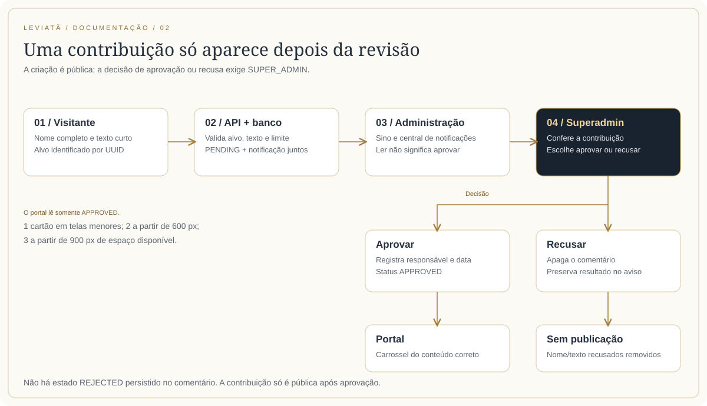
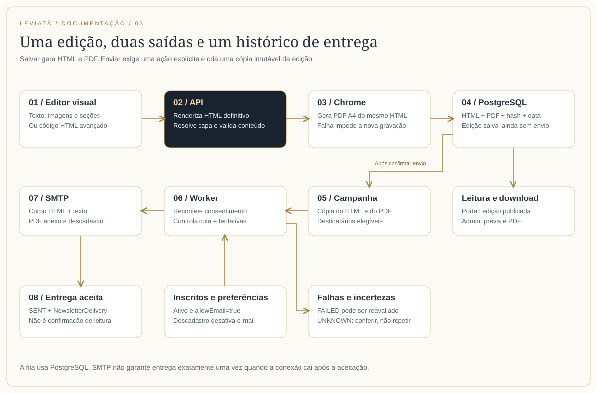

# Manual completo do portal e da administração

## 1. Perfis de acesso

| Perfil | O que faz |
| --- | --- |
| Visitante | Consulta o portal, abre mídias e documentos, lê boletins publicados, assina a newsletter e envia comentários para revisão |
| ADMIN | Usa os cadastros, acompanha notificações, cria avisos/lembretes, gerencia conteúdos e campanhas, edita sua própria conta |
| SUPER_ADMIN | Tem as funções administrativas e também gerencia outras contas e decide a aprovação/recusa de comentários |

`Person` e `User` são entidades diferentes. Cadastrar um pesquisador ou um participante externo não cria um usuário de acesso. Ser coordenador em `Person.category` não concede permissão `SUPER_ADMIN`. Há somente dois níveis no enum de acesso atual: `ADMIN` e `SUPER_ADMIN`.

## 2. Navegação pública

O cabeçalho organiza O Grupo, Publicações, Instrumentos de Pesquisa, Atividades, Agenda, Notícias e Contato. Há submenus, indicação da seção atual, versões desktop/celular, fechamento com Escape e tratamento de foco no menu móvel. A logo leva à página inicial; o atalho existente de **três cliques rápidos** leva à área administrativa. O atalho não substitui a autenticação.

O rodapé oferece informações do grupo, inscrição por e-mail, redes sociais e retorno ao topo. Os links sociais apontam para Facebook, Instagram e YouTube do Leviatã. O tema pode ser alternado pelo controle sol/lua e é preservado entre navegações e abas. A preferência padrão é clara.

As listas exibem estados de carregamento, falta de registros e indisponibilidade. O tratamento de erro varia entre telas; não se deve interpretar toda mensagem de lista vazia como comprovação de que o banco está vazio. O mapa integral de rotas ao fim deste manual inclui aliases e telas que não aparecem diretamente no menu.

## 3. Página inicial e apresentação do grupo

Em `/`, a imagem de abertura muda conforme a proporção da tela. A apresentação institucional é editorial, escrita no código. Linhas temáticas, livros e notícias são consultados na API. Livros e notícias usam carrosséis; as linhas abrem seus detalhes. Não é preciso alterar a página inicial a cada novo cadastro desses recursos.

Em `/grupo`, o texto apresenta a fundação em 2019 e o recorte da pesquisa. O vídeo principal é identificado no catálogo pelo título normalizado “Grupo Leviatã e o Cativeiro”; os demais vídeos aparecem em uma coleção separada. Esse critério textual é relevante para quem cadastra ou renomeia o vídeo institucional.

Fontes: `src/pages/Home/index.tsx`, `src/pages/Group/index.tsx` e `src/components/NavBar` do front.

## 4. Pessoas, pesquisadores e participantes externos

A página de pesquisadores considera pessoas ativas, retira `DISCENTE` e `EXTERNO` da apresentação geral e separa nacionais e colaboradores internacionais conforme o código da nacionalidade. `displayOrder` controla a ordem editorial. Os cards/perfis apresentam, quando disponíveis, nome, título, instituição, biografia, foto e links para Lattes, ORCID, LinkedIn ou site.

No admin, Pessoas possui listagem, busca, filtros, ordenação, paginação, cadastro, edição, detalhe e exclusão lógica. O formulário permite categoria, status, ordem, dados biográficos e acadêmicos, redes e foto. Para integrantes, os campos acadêmicos/nacionalidade/e-mail seguem as validações do cadastro; para `EXTERNO`, nome e categoria são suficientes e os dados acadêmicos podem ficar sem preenchimento. Valores fornecidos continuam sendo validados.

As categorias são docente, discente, egresso, pesquisador, subcoordenador, coordenador e participante externo. O vínculo em uma atividade define a função da pessoa naquele evento; a categoria geral não transforma um jurado em integrante do grupo.

**Exemplo de convidado para júri:** crie ou edite a pessoa como Participante externo, mantenha-a ativa, abra o formulário do júri e selecione-a em Jurados. Ela aparece no detalhe do júri sem entrar no diretório de pesquisadores. Se já existia um cadastro, reaproveite-o para preservar os vínculos.

Países, títulos acadêmicos e instituições alimentam seletores. Eles têm endpoints de consulta protegidos; não há telas completas de CRUD desses três catálogos no painel atual. Seus dados iniciais são mantidos em seeds/arquivos JSON da API.

## 5. Publicações: livros, artigos, trabalhos e dossiês

`/publicacoes` usa abas de Livros, Artigos, Trabalhos e Dossiês. As abas respondem ao teclado (setas, Home e End). A query `?publicacao=<UUID-ou-slug>` permite abrir a aba correspondente a uma publicação relacionada por notícia e identifica um item indisponível.

**Livros:** o cadastro guarda título, subtítulo, descrição, autores, ano, editora, ISBN, URL externa e capa, conforme preenchimento permitido. Os cards apresentam a obra e os autores e oferecem o destino externo quando informado. A listagem administrativa tem total/paginação, busca e ações para detalhe, edição e exclusão.

**Artigos e dossiês de publicação:** compartilham o modelo `Article` e se distinguem pelo enum `ARTICLE`/`DOSSIER`. Possuem título, resumo, autores, ano, revista, volume, DOI, link e capa. São exibidos separadamente nas abas do portal, sem duplicar o cadastro.

**Trabalhos apresentados:** usam outro modelo, `PresentedWork`, com data, local, autores, encontro relacionado, links e galeria. Têm linha do tempo e detalhe próprios, além da aba de publicações. Documentos, inscrição, transmissão e gravação só aparecem quando existe um endereço utilizável.

**Atenção à palavra dossiê:** o dossiê bibliográfico de `ResearchInstrument.type=DOSSIER` pertence a Instrumentos de Pesquisa. O dossiê editorial de `Article.type=DOSSIER` pertence a Publicações. Os nomes são próximos, mas os modelos, formulários e rotas são diferentes.

## 6. Instrumentos de pesquisa

O portal possui uma entrada em `/instrumentos` e três coleções: planilhas biblio-temáticas/dossiês, catálogos e bancos de dados. Todas usam `ResearchInstrument`; o tipo decide a lista e a rota de detalhe. Existe também `/instrumentos/registro/:id`, usado em vínculos genéricos de notícias.

Cada instrumento reúne título, tipo, período, conteúdo descritivo, pessoas relacionadas, PDF e link externo. O admin permite filtrar por tipo na listagem. O período usa `startYear` e `endYear`: anos iguais aparecem uma vez; dois anos diferentes formam um intervalo; um extremo isolado pode ser apresentado como “A partir de” ou “Até”. A representação visual não altera o valor do banco.

O PDF enviado ao instrumento não é o PDF automático da newsletter. O instrumento aceita upload e pode referenciar um documento já publicado. Seu leitor tem área de tamanho controlado, ajusta a página ao espaço disponível e mantém a barra de ações e paginação. Oferece anterior/próxima, abrir em outra aba, download, impressão e tela cheia quando o navegador suporta. A impressão reutiliza o documento carregado e limpa recursos temporários.

As descrições transformam endereços HTTP/HTTPS em links clicáveis sem exigir HTML na API. Pontuação final é separada do endereço. O recurso trata texto como texto e não interpreta tags digitadas como código de página.

Fonte: `src/components/ResearchInstrumentDetails`, `ResearchInstrumentList`, `DocumentViewer` e `src/utils/researchInstruments.ts`.

## 7. Pesquisas, núcleo e apoiadores

Pesquisas são representadas pelo modelo `Search` da API e expostas em `/research`. O painel usa o nome Pesquisas e permite título, conteúdo, pessoas, capa e duas coleções independentes: fotos e imagens de apoiadores. A página de detalhes reúne esses materiais e os participantes.

A listagem e os detalhes públicos ficam em `/atividades/pesquisas`. O núcleo “Em costas negras” reaproveita registros de pesquisa cujo título ou slug contém esse termo normalizado. Portanto, a associação atual do núcleo depende dessa convenção textual, não de uma tabela específica chamada Núcleo.

Participantes externos vinculados à pesquisa podem aparecer em seção própria. Imagens de apoiadores não se misturam à galeria fotográfica, embora ambas usem a infraestrutura de imagens.

## 8. Atividades e agendas: quatro domínios relacionados

### 8.1 Júris históricos

O cadastro guarda título, descrição, data, local, capa horizontal, galeria e links para documento, inscrição, gravação e reunião/transmissão. Pessoas são vinculadas a funções independentes: juízes, jurados, acusação/promotores, defesa e oficiais de justiça. Cada pessoa é selecionada de um cadastro existente; externos são aceitos.

No portal, os cards são compactos, com título/ícone alinhados à esquerda. O detalhe usa moldura, apresentação de data, capa retangular horizontal, perfis dos participantes, links, galeria e comentários. O principal ponto de manutenção é `GalleryDetails` para júris; `JuriDetails` é uma entrada curta que o reutiliza.

### 8.2 Encontros, seminários e mostras

Os três são o modelo `Meeting`, com tipos `MEETING`, `SEMINAR` e `DOCUMENTARY`. O cadastro inclui título, descrição, data, local, capa, palestrantes, URLs de inscrição/transmissão/gravação, galeria e status de atividade interna (`isInternal`). As listagens institucionais do portal e agendas específicas filtram atividades internas; um registro externo não deve ser considerado automaticamente apagado por não aparecer ali.

Há coleções de atividades e linhas do tempo de agenda para cada tipo. As telas de detalhe são compartilhadas e preservam o conteúdo do registro. As rotas antigas de encontros/seminários continuam registradas, assim como a rota genérica `/atividades/encontros-e-seminarios/:type/:id`.

### 8.3 Bancas

`Board` registra título, candidato, orientador, membros, data, link de reunião e galeria. A agenda de bancas apresenta as informações e links disponíveis, e o detalhe reúne participantes e fotos. Candidato e orientador são vínculos diferentes; a banca não é um júri histórico.

### 8.4 Agenda geral

`Schedule` é um cadastro independente de avisos de agenda. Possui título, subtítulo, descrição, início, fim opcional, local e URL. A data final não pode ser anterior à inicial. O texto de ajuda explica que o fim é opcional para eventos com duração ou vários dias.

O portal combina datas e estados nas linhas do tempo: em breve, realizados/em andamento ou data a confirmar, conforme os dados e o tipo de tela. A agenda geral não cria automaticamente um `Meeting` ou uma `Board`. Para ter os detalhes completos de um encontro, cadastre também o recurso específico quando necessário.

## 9. Linhas temáticas e vídeos

`Thematic` possui título, descrição, coordenador opcional e vídeo principal opcional. Os vídeos complementares são vínculos `ThematicVideo`, cada um com vídeo já cadastrado, título próprio, descrição e pessoa opcional. A mesma mídia pode ser reutilizada sem duplicar o catálogo de vídeos.

No formulário da temática, é possível adicionar, editar e retirar os vídeos complementares. O envio da lista substitui os vínculos anteriores; omitir a lista preserva os existentes, e enviar `[]` remove todos. Remover o vínculo mantém o vídeo no catálogo. IDs de outra temática, repetições e referências indisponíveis são rejeitados pela API.

O portal mostra as linhas na página inicial e em `/grupo/linhas-tematicas`; o detalhe apresenta descrição, coordenação, vídeos e comentários. Vídeos também possuem cadastro próprio com título, link de incorporação, descrição e pessoas relacionadas. O sistema referencia vídeos externos; não implementa uma plataforma própria de streaming ou edição de vídeo.

## 10. Notícias e seus destinos

Uma notícia guarda título, descrição, data, categoria, capa e galeria. As categorias são publicação, evento, premiação, estágio, pesquisa, podcast e convocação. A categoria aparece de forma compacta sobre a imagem do card.

O destino pode ser externo (`externalUrl`) ou relacionado a conteúdo interno (`relatedType`/`relatedId`). Os tipos relacionados cobrem banca, júri, encontro, publicação, instrumento, temática, pesquisa e trabalho apresentado. O frontend converte o tipo e o UUID em uma rota adequada, em vez de exigir que a pessoa monte o caminho manualmente.

Os detalhes da notícia continuam tendo descrição, imagens e comentários próprios, inclusive em notícias com destino externo. Um comentário da notícia não é transferido para a página do evento relacionado. URLs escritas na descrição viram hyperlinks automaticamente no portal; não é preciso alterar o texto na API para adicionar tags `<a>`.

## 11. Comentários: do envio à publicação

O formulário aparece ao final dos detalhes das temáticas, instrumentos, bancas, júris, encontros/seminários/documentários, trabalhos, pesquisas e notícias. Não foi encontrado esse recurso nos cards de livros ou nos detalhes de pessoas.

O visitante informa **nome completo**, de 3 a 120 caracteres e ao menos duas palavras, e **mensagem curta**, de 3 a 300 caracteres. O nome é normalizado para retirar espaços repetidos. O texto não aceita HTML executável. O envio guarda um comentário `PENDING` e sua notificação na mesma transação; a confirmação ao visitante não significa que o comentário já está público.

No portal, a lista carrega ao abrir a página e consulta apenas `APPROVED`. Enquanto não há comentários disponíveis, a interface usa a mensagem amigável de ausência de contribuições. Há navegação/carregamento de mais comentários. O carrossel mostra três cartões por grupo a partir de 900 px de espaço, dois a partir de 600 px e um abaixo disso.

O admin vê autor, texto e página de origem na central de notificações. **Somente o superadmin aprova ou recusa.** Aprovar registra responsável/data e publica no carrossel do alvo correto. Recusar apaga fisicamente o comentário; a notificação preserva o resultado, sem copiar os dados removidos do comentário. Uma leitura não aprova a mensagem.

O `targetId` é o UUID, mesmo se a URL usa slug. Alvos excluídos/indisponíveis não aceitam publicação de novas mensagens. A moderação usa atualização condicional para evitar decisões concorrentes incompatíveis. Há limite em memória de cinco tentativas por minuto por IP/instância da API.

## 12. Notificações administrativas

O sino do header apresenta badge de não lidas e uma prévia dos registros. O menu lateral repete o contador em Notificações; quando recolhido, utiliza um ponto indicador. O provider consulta contadores a cada 30 segundos e quando a aba recebe foco/volta à visibilidade.

A central separa tipos `INFO`, `REMINDER` e `COMMENT` e estados de filtro todos, não lidas, pendentes e agendadas. Avisos e lembretes são compartilhados com a equipe; a leitura é individual, armazenada em `NotificationRead` por usuário/notificação. “Marcar todas como lidas” alcança apenas o que já está visível para aquele usuário.

Avisos/lembretes aceitam título de até 120 e mensagem de até 500 caracteres. Um lembrete pode usar `visibleAt`, com fuso explícito; antes desse instante fica em Agendadas e não aumenta o badge de avisos visíveis. O sistema não envia push ao navegador nem notificação de sistema operacional: a atualização é por consultas da aplicação.

Não foi identificado contador de visitantes, Google Analytics, detecção geral de novos visitantes ou geração automática de aviso para toda inscrição de newsletter. Essas ideias aparecem em anotações históricas, mas não devem ser tratadas como recursos existentes.

## 13. Newsletter: cadastro visual, leitura, PDF e campanha

### 13.1 Inscrição pública

Os formulários do rodapé e de páginas públicas oferecem variações: e-mail sozinho, nome/sobrenome opcionais e a versão completa com telefone opcional. Nome e sobrenome são reunidos antes do envio. Apenas o e-mail é obrigatório; há validação local e retorno sem apagar o rascunho quando a requisição falha.

A API normaliza o e-mail e faz upsert, evitando duplicar a pessoa. Uma nova inscrição reativa recebimento, status e eventual exclusão lógica. Dados opcionais ausentes não apagam dados já cadastrados. O modelo guarda autorização de WhatsApp, mas não há envio automático por WhatsApp implementado.

### 13.2 Montar uma edição sem escrever código

1. Abra Newsletter → Nova newsletter e preencha título e assunto do e-mail.
2. Escolha o formato da capa: quadrado, horizontal ou vertical. Os controles ficam à esquerda da prévia e os Dados gerais à direita em telas largas.
3. Selecione a imagem. O recorte abre no formato escolhido; confirme para aplicá-lo. Também há opção de URL de capa.
4. Escolha Memória (2023), Editorial (2025) ou Contemporâneo (2026). A troca mantém o conteúdo.
5. Personalize nome do boletim, período/edição, subtítulo, abertura, rodapé, fundo e moldura.
6. Adicione seções e conteúdos. Use Matérias para texto com imagem e Chamadas para listas compactas. Um item aceita título, texto, detalhes como data/local, imagem/legenda e link com rótulo de botão.
7. Reordene seções e itens com as setas. Use Prévia antes de salvar; ela não cadastra nem envia a edição.
8. Informe a publicação e salve. O envio aos inscritos é uma ação separada ou uma opção explícita após salvar.

Os modelos são `CLASSIC`, `EDITORIAL` e `MAGAZINE`; os fundos são `paper`, `white` e `ink`; as molduras são `double`, `line` e `none`. O padrão atual é Contemporâneo, papel e moldura dupla. Uma edição visual precisa ter pelo menos um item com título ou texto.

Limites estruturais: até 20 seções e 30 conteúdos por seção. Nome do boletim: 200 caracteres; subtítulo: 500; identificação da edição: 100; abertura: 10.000; rodapé: 2.000. Por item: título 300; texto 20.000; detalhes 500; descrição da imagem 300; rótulo do botão 100; URLs 2.000; identificadores internos 80. HTML personalizado tem limite de 200.000 caracteres no contrato estruturado.

### 13.3 Prévia, modo avançado e versões antigas

O modo visual persiste a estrutura em `contentData`; o servidor monta o HTML definitivo usando a capa já enviada. A prévia aceita conteúdo incompleto e uma capa local. Os endereços digitados no texto visual se tornam links, enquanto tags comuns são escapadas.

“Avançado · editar código HTML” permite personalização. A estrutura visual é preservada para poder retornar a ela. Gerar novo HTML a partir do visual substitui a personalização; o formulário torna essa decisão explícita. `{{newsletterCover}}` é substituído pela URL definitiva da capa. Edições antigas sem estrutura abrem preservando o HTML existente, em vez de receber um modelo novo automaticamente.

### 13.4 PDF automático

Não existe campo manual de URL de PDF no novo cadastro. Ao salvar, o mesmo HTML é renderizado em PDF A4, com imagens, cores e moldura. O documento é salvo no banco, com hash da origem e data. Quando conteúdo/capa muda, é gerado novamente; se a geração falhar, a atualização do registro não é concluída e a edição anterior permanece no banco.

O admin tem Baixar PDF. No portal, o download está disponível para edições publicadas. Rascunhos exigem autenticação administrativa para download. Registros antigos recebem PDF a partir de seu HTML quando necessário. O arquivo binário não é enviado junto às respostas JSON de listagem.

“Mesmo layout” significa mesma fonte HTML, identidade e conteúdo; a paginação A4 acrescenta regras para evitar títulos/botões isolados. Clientes de e-mail têm suporte diferente a fundos, sombras e outros estilos, portanto a renderização não é pixel a pixel idêntica entre todos os leitores.

### 13.5 Publicação e portal

A página de boletins apresenta a edição publicada mais recente em destaque, organiza o arquivo por ano/data e separa próximas edições/rascunhos conforme os dados. A decisão de publicação do portal considera o dia no Brasil. O leitor abre o HTML isolado; a interface ao redor acompanha o tema, mas não inverte o conteúdo editorial.

**Limite importante do backend atual:** `GET /newsletter` é público e o repositório não filtra `publishedAt`. A separação visual do portal não constitui sigilo de rascunho HTML. O endpoint de PDF tem checagem própria. Não armazene conteúdo confidencial em um rascunho supondo que a listagem pública o oculta.

### 13.6 Enviar agora ou depois

O formulário oferece “Enviar para todos os inscritos após salvar”, desmarcado por padrão. Ao escolher, primeiro salva a edição e depois solicita a campanha. Se a segunda etapa falhar, o cadastro permanece salvo e o painel direciona para acompanhamento, evitando duplicação.

Nos detalhes, “Envio e entregas” mostra elegibilidade, assunto e confirmação antes do envio em massa. Só são considerados inscritos ativos, não excluídos e com `allowEmail=true`, sem entrega anterior da mesma edição. A publicação deve estar liberada e o e-mail configurado/ativo. Há um envio de teste para um destinatário escolhido, independente da campanha.

A campanha guarda cópias do HTML e PDF. O e-mail usa HTML no corpo, texto alternativo e PDF em anexo. Alterar a newsletter depois não muda a cópia já enfileirada. A interface atualiza a campanha a cada cinco segundos enquanto há processamento.

### 13.7 Entregas e recuperação

| Estado do destinatário | Interpretação e ação |
| --- | --- |
| `PENDING` | Aguarda o worker; pode ser cancelado antes de começar |
| `SENDING` | Reservado/em processamento; uma aceitação SMTP em curso pode terminar após cancelar |
| `SENT` | SMTP aceitou a mensagem; não comprova leitura nem caixa de entrada |
| `FAILED` | Falha confirmada; o admin pode solicitar nova tentativa nos casos permitidos |
| `SKIPPED` | Ignorado/cancelado por regras de elegibilidade ou campanha |
| `UNKNOWN` | Resultado incerto; conferir no provedor, sem reenvio automático |

`NewsletterDelivery` é o histórico de envios aceitos, não a própria fila. O registro é gravado junto do sucesso numa transação. “Envios realizados” consulta esse histórico, inclusive registros anteriores ao worker. `sentAt` da edição é atualizado automaticamente ao concluir uma campanha com ao menos uma aceitação e sem falhas/pendências; não é data editável de envio fictício.

A fila padrão reserva a cada cinco segundos, limita 400 destinatários por janela de 24 horas e permite até três tentativas de falha temporária confirmada. Falhas de autenticação pausam o worker por uma hora. Processamentos interrompidos por mais de dez minutos podem virar UNKNOWN. O processo precisa permanecer ativo para trabalhar; uma função HTTP efêmera não equivale a um worker contínuo.

### 13.8 Descadastro

O rodapé de cada e-mail tem token assinado e link individual. GET abre a confirmação; POST efetiva o cancelamento, também compatível com o cabeçalho de one-click unsubscribe. Essa separação reduz cancelamentos por robôs que apenas visitam links. O descadastro desativa `allowEmail` e preenche a data, preservando o cadastro e eventual preferência de WhatsApp. Não precisa estar autenticado.

## 14. Uso cotidiano do painel

### 14.1 Login e sessão

`/admin/login` tem retorno ao portal, alternância de tema, campos compatíveis com gerenciadores de senha, botão de mostrar/ocultar senha e indicador de carregamento. O envio repetido é bloqueado enquanto há uma tentativa. As mensagens diferenciam credencial recusada, muitas tentativas, indisponibilidade e conexão. O texto digitado permanece para correção.

Ao voltar ao portal durante uma tentativa, uma resposta tardia não cria a sessão nem reabre o admin. Depois de entrar, o painel permite sair pelo menu da conta. Alterações relevantes de credenciais ou permissão invalidam sessões antigas no backend.

### 14.2 Sidebar e dashboard

O menu agrupa Visão geral, Comunicação, Pesquisa e acervo, Atividades e Administração. A busca aceita termos sem acento, palavras combinadas e nome do grupo. A seção atual permanece destacada, inclusive nos detalhes/edição. Recolher mantém ícones com nomes acessíveis e dicas; Usuários só aparece para superadmin.

No celular, o menu abre como gaveta, mantém o foco dentro dele, inclui a busca na navegação por Tab, fecha por Escape/backdrop/botão e devolve o foco ao acionador. O link de retorno ao site fica no rodapé do menu.

O dashboard consulta três conjuntos independentemente: resumo, próximos quatro eventos da agenda e quatro notícias recentes. Mostra seis contadores: pessoas ativas, livros, artigos, dossiês editoriais, notícias e encontros. O total exibido é a soma dessas seis categorias, **não todas as tabelas do banco**. Há atalhos para criar notícia, agenda, livro, pesquisa, encontro e newsletter. Uma falha de um bloco não precisa impedir os demais.

### 14.3 Listagens e formulários

As listagens administrativas usam busca/filtros pertinentes, paginação com total, ordenação e ações. Ao mudar filtros, a primeira página é restabelecida. Uma página que deixa de existir após exclusão pode ser ajustada para a última válida. Em telas menores, os campos da tabela mantêm associação com os cabeçalhos.

O padrão de cadastro é: preencher, escolher vínculos, ajustar arquivos e Salvar. Campos opcionais têm ajuda onde aplicável. Slugs são gerados de títulos/nomes e podem mudar quando o conteúdo é renomeado. A exclusão usa confirmação e, na maior parte do domínio, retira o registro da leitura normal sem apagar a linha fisicamente. Não há promessa de redirecionamento dos slugs antigos.

### 14.4 Capas, recorte e galerias

O editor permite zoom, arraste, rotação e recorte antes da aplicação. Selecionar/cancelar não envia a imagem original automaticamente; o callback recebe o arquivo recortado ao confirmar. Um novo ajuste pode reutilizar o original, evitando recortar repetidamente uma imagem já cortada. Recursos com proporção fixa, como a capa do júri horizontal, mantêm essa proporção; a capa de newsletter oferece três formatos.

As galerias de bancas, júris, encontros, trabalhos, pesquisas e notícias aceitam título e descrição opcionais. Arquivos ficam pendentes no formulário até salvar. O registro principal é gravado antes das mídias; falha parcial preserva o identificador e as etapas concluídas para repetir sem duplicar o registro. A remoção de arquivos acontece após os novos uploads. São operações em serviços diferentes, portanto não formam uma transação única de banco/Cloudinary.

### 14.5 Minha conta e Usuários

Minha conta permite nome, sobrenome, e-mail e senha. Alterar e-mail ou senha exige a senha atual e demanda novo login. Essa tela não modifica nível/status.

O superadmin gerencia outras contas: criar, consultar, filtrar, editar e excluir logicamente. Criação exige e-mail e senha de pelo menos oito caracteres e até 72 bytes UTF-8; senha em branco na edição preserva a atual. As regras impedem excluir/desativar/rebaixar a própria conta e preservam pelo menos um superadmin ativo por transação. Senhas e hashes de refresh tokens não são enviados nas respostas.

## 15. Mapa integral das telas e aliases

Cada linha abaixo corresponde a uma rota com caminho ou índice declarada. Wrappers de layout/proteção são indicados separadamente na referência de cobertura. `:id`, `:slug` e `:type` são parâmetros, não textos a serem digitados literalmente. Algumas páginas aceitam UUID ou slug apesar do nome `:id`.

| Caminho | Acesso / papel | Tela ou composição declarada | Fonte |
| --- | --- | --- | --- |
| `/admin` | Sessão administrativa — wrapper de layout | `<AdminDataProvider>         <NotificationsProvider>           <AdminLayout />         </NotificationsProvider>       </AdminDataProvider>` | [Fonte](<leviata/src/admin/routes/admin.routes.tsx#L58>) |
| `/admin` | Sessão administrativa | `<AdminDashboard />` | [Fonte](<leviata/src/admin/routes/admin.routes.tsx#L68>) |
| `/admin/notificacoes` | Sessão administrativa | `<AdminNotifications />` | [Fonte](<leviata/src/admin/routes/admin.routes.tsx#L69>) |
| `/admin/minha-conta` | Sessão administrativa | `<UserForm account /> — modo conta própria` | [Fonte](<leviata/src/admin/routes/admin.routes.tsx#L70>) |
| `/admin/usuarios` | Superadmin | `<AdminUsers />` | [Fonte](<leviata/src/admin/routes/admin.routes.tsx#L72>) |
| `/admin/usuarios/novo` | Superadmin | `<UserForm />` | [Fonte](<leviata/src/admin/routes/admin.routes.tsx#L73>) |
| `/admin/usuarios/:id` | Superadmin | `<UserView />` | [Fonte](<leviata/src/admin/routes/admin.routes.tsx#L74>) |
| `/admin/usuarios/:id/editar` | Superadmin | `<UserForm />` | [Fonte](<leviata/src/admin/routes/admin.routes.tsx#L75>) |
| `/admin/agenda` | Sessão administrativa | `<AdminSchedule />` | [Fonte](<leviata/src/admin/routes/admin.routes.tsx#L79>) |
| `/admin/agenda/novo` | Sessão administrativa | `<ScheduleForm />` | [Fonte](<leviata/src/admin/routes/admin.routes.tsx#L80>) |
| `/admin/agenda/:slug` | Sessão administrativa | `<ScheduleView />` | [Fonte](<leviata/src/admin/routes/admin.routes.tsx#L81>) |
| `/admin/agenda/:slug/editar` | Sessão administrativa | `<ScheduleForm />` | [Fonte](<leviata/src/admin/routes/admin.routes.tsx#L82>) |
| `/admin/newsletter` | Sessão administrativa | `<AdminNewsletters />` | [Fonte](<leviata/src/admin/routes/admin.routes.tsx#L85>) |
| `/admin/newsletter/novo` | Sessão administrativa | `<NewsletterForm />` | [Fonte](<leviata/src/admin/routes/admin.routes.tsx#L86>) |
| `/admin/newsletter/:slug` | Sessão administrativa | `<NewsletterView />` | [Fonte](<leviata/src/admin/routes/admin.routes.tsx#L87>) |
| `/admin/newsletter/:slug/editar` | Sessão administrativa | `<NewsletterForm />` | [Fonte](<leviata/src/admin/routes/admin.routes.tsx#L88>) |
| `/admin/pessoas` | Sessão administrativa | `<AdminPeople />` | [Fonte](<leviata/src/admin/routes/admin.routes.tsx#L91>) |
| `/admin/pessoas/:slug` | Sessão administrativa | `<PersonView />` | [Fonte](<leviata/src/admin/routes/admin.routes.tsx#L93>) |
| `/admin/pessoas/novo` | Sessão administrativa | `<PersonForm />` | [Fonte](<leviata/src/admin/routes/admin.routes.tsx#L95>) |
| `/admin/pessoas/:slug/editar` | Sessão administrativa | `<PersonForm />` | [Fonte](<leviata/src/admin/routes/admin.routes.tsx#L97>) |
| `/admin/livros` | Sessão administrativa | `<AdminBooks />` | [Fonte](<leviata/src/admin/routes/admin.routes.tsx#L100>) |
| `/admin/livros/:slug` | Sessão administrativa | `<BookView />` | [Fonte](<leviata/src/admin/routes/admin.routes.tsx#L102>) |
| `/admin/livros/novo` | Sessão administrativa | `<BookForm />` | [Fonte](<leviata/src/admin/routes/admin.routes.tsx#L104>) |
| `/admin/livros/:slug/editar` | Sessão administrativa | `<BookForm />` | [Fonte](<leviata/src/admin/routes/admin.routes.tsx#L106>) |
| `/admin/artigos` | Sessão administrativa | `<AdminArticles />` | [Fonte](<leviata/src/admin/routes/admin.routes.tsx#L109>) |
| `/admin/artigos/:slug` | Sessão administrativa | `<ArticleView />` | [Fonte](<leviata/src/admin/routes/admin.routes.tsx#L111>) |
| `/admin/artigos/novo` | Sessão administrativa | `<ArticleForm />` | [Fonte](<leviata/src/admin/routes/admin.routes.tsx#L113>) |
| `/admin/artigos/:slug/editar` | Sessão administrativa | `<ArticleForm />` | [Fonte](<leviata/src/admin/routes/admin.routes.tsx#L115>) |
| `/admin/noticias` | Sessão administrativa | `<AdminNews />` | [Fonte](<leviata/src/admin/routes/admin.routes.tsx#L118>) |
| `/admin/noticias/:slug` | Sessão administrativa | `<NewsView />` | [Fonte](<leviata/src/admin/routes/admin.routes.tsx#L120>) |
| `/admin/noticias/novo` | Sessão administrativa | `<NewsForm />` | [Fonte](<leviata/src/admin/routes/admin.routes.tsx#L122>) |
| `/admin/noticias/:slug/editar` | Sessão administrativa | `<NewsForm />` | [Fonte](<leviata/src/admin/routes/admin.routes.tsx#L124>) |
| `/admin/encontros` | Sessão administrativa | `<AdminMeetings />` | [Fonte](<leviata/src/admin/routes/admin.routes.tsx#L127>) |
| `/admin/encontros/:slug` | Sessão administrativa | `<MeetingView />` | [Fonte](<leviata/src/admin/routes/admin.routes.tsx#L129>) |
| `/admin/encontros/novo` | Sessão administrativa | `<MeetingForm />` | [Fonte](<leviata/src/admin/routes/admin.routes.tsx#L131>) |
| `/admin/encontros/:slug/editar` | Sessão administrativa | `<MeetingForm />` | [Fonte](<leviata/src/admin/routes/admin.routes.tsx#L133>) |
| `/admin/bancas` | Sessão administrativa | `<AdminBoards />` | [Fonte](<leviata/src/admin/routes/admin.routes.tsx#L136>) |
| `/admin/bancas/:slug` | Sessão administrativa | `<BoardView />` | [Fonte](<leviata/src/admin/routes/admin.routes.tsx#L138>) |
| `/admin/bancas/novo` | Sessão administrativa | `<BoardForm />` | [Fonte](<leviata/src/admin/routes/admin.routes.tsx#L140>) |
| `/admin/bancas/:slug/editar` | Sessão administrativa | `<BoardForm />` | [Fonte](<leviata/src/admin/routes/admin.routes.tsx#L142>) |
| `/admin/juris` | Sessão administrativa | `<AdminJuries />` | [Fonte](<leviata/src/admin/routes/admin.routes.tsx#L145>) |
| `/admin/juris/:slug` | Sessão administrativa | `<JuryView />` | [Fonte](<leviata/src/admin/routes/admin.routes.tsx#L147>) |
| `/admin/juris/novo` | Sessão administrativa | `<JuryForm />` | [Fonte](<leviata/src/admin/routes/admin.routes.tsx#L149>) |
| `/admin/juris/:slug/editar` | Sessão administrativa | `<JuryForm />` | [Fonte](<leviata/src/admin/routes/admin.routes.tsx#L151>) |
| `/admin/apresentacoes-trabalhos` | Sessão administrativa | `<AdminPresentedWorks />` | [Fonte](<leviata/src/admin/routes/admin.routes.tsx#L154>) |
| `/admin/apresentacoes-trabalhos/:slug` | Sessão administrativa | `<PresentedWorkView />` | [Fonte](<leviata/src/admin/routes/admin.routes.tsx#L156>) |
| `/admin/apresentacoes-trabalhos/novo` | Sessão administrativa | `<PresentedWorkForm />` | [Fonte](<leviata/src/admin/routes/admin.routes.tsx#L161>) |
| `/admin/apresentacoes-trabalhos/:slug/editar` | Sessão administrativa | `<PresentedWorkForm />` | [Fonte](<leviata/src/admin/routes/admin.routes.tsx#L166>) |
| `/admin/tematicas` | Sessão administrativa | `<AdminThematics />` | [Fonte](<leviata/src/admin/routes/admin.routes.tsx#L172>) |
| `/admin/tematicas/:slug` | Sessão administrativa | `<ThematicView />` | [Fonte](<leviata/src/admin/routes/admin.routes.tsx#L174>) |
| `/admin/tematicas/novo` | Sessão administrativa | `<ThematicForm />` | [Fonte](<leviata/src/admin/routes/admin.routes.tsx#L176>) |
| `/admin/tematicas/:slug/editar` | Sessão administrativa | `<ThematicForm />` | [Fonte](<leviata/src/admin/routes/admin.routes.tsx#L178>) |
| `/admin/atividades` | Sessão administrativa | `<AdminThematics />` | [Fonte](<leviata/src/admin/routes/admin.routes.tsx#L181>) |
| `/admin/atividades/:slug` | Sessão administrativa | `<ThematicView />` | [Fonte](<leviata/src/admin/routes/admin.routes.tsx#L183>) |
| `/admin/atividades/novo` | Sessão administrativa | `<ThematicForm />` | [Fonte](<leviata/src/admin/routes/admin.routes.tsx#L185>) |
| `/admin/atividades/:slug/editar` | Sessão administrativa | `<ThematicForm />` | [Fonte](<leviata/src/admin/routes/admin.routes.tsx#L187>) |
| `/admin/videos` | Sessão administrativa | `<AdminVideos />` | [Fonte](<leviata/src/admin/routes/admin.routes.tsx#L190>) |
| `/admin/videos/:slug` | Sessão administrativa | `<VideoView />` | [Fonte](<leviata/src/admin/routes/admin.routes.tsx#L192>) |
| `/admin/videos/novo` | Sessão administrativa | `<VideoForm />` | [Fonte](<leviata/src/admin/routes/admin.routes.tsx#L194>) |
| `/admin/videos/:slug/editar` | Sessão administrativa | `<VideoForm />` | [Fonte](<leviata/src/admin/routes/admin.routes.tsx#L196>) |
| `/admin/pesquisas` | Sessão administrativa | `<AdminResearch />` | [Fonte](<leviata/src/admin/routes/admin.routes.tsx#L199>) |
| `/admin/pesquisas/:slug` | Sessão administrativa | `<SearchView />` | [Fonte](<leviata/src/admin/routes/admin.routes.tsx#L201>) |
| `/admin/pesquisas/novo` | Sessão administrativa | `<SearchForm />` | [Fonte](<leviata/src/admin/routes/admin.routes.tsx#L203>) |
| `/admin/pesquisas/:slug/editar` | Sessão administrativa | `<SearchForm />` | [Fonte](<leviata/src/admin/routes/admin.routes.tsx#L205>) |
| `/admin/instrumentos-pesquisa` | Sessão administrativa | `<AdminResearchInstruments />` | [Fonte](<leviata/src/admin/routes/admin.routes.tsx#L208>) |
| `/admin/instrumentos-pesquisa/:slug` | Sessão administrativa | `<ResearchInstrumentView />` | [Fonte](<leviata/src/admin/routes/admin.routes.tsx#L213>) |
| `/admin/instrumentos-pesquisa/novo` | Sessão administrativa | `<ResearchInstrumentForm />` | [Fonte](<leviata/src/admin/routes/admin.routes.tsx#L218>) |
| `/admin/instrumentos-pesquisa/:slug/editar` | Sessão administrativa | `<ResearchInstrumentForm />` | [Fonte](<leviata/src/admin/routes/admin.routes.tsx#L223>) |
| `/` | Público | `<Home />` | [Fonte](<leviata/src/routes/index.routes.tsx#L44>) |
| `/grupo` | Público | `<Group />` | [Fonte](<leviata/src/routes/index.routes.tsx#L46>) |
| `/grupo/pesquisadores` | Público | `<Researchers />` | [Fonte](<leviata/src/routes/index.routes.tsx#L47>) |
| `/grupo/linhas-tematicas` | Público | `<ThematicLines />` | [Fonte](<leviata/src/routes/index.routes.tsx#L48>) |
| `/grupo/linhas-tematicas/tematica/:id` | Público | `<ThematicDetails />` | [Fonte](<leviata/src/routes/index.routes.tsx#L49>) |
| `/publicacoes` | Público | `<Publications />` | [Fonte](<leviata/src/routes/index.routes.tsx#L54>) |
| `/instrumentos` | Público | `<Instruments />` | [Fonte](<leviata/src/routes/index.routes.tsx#L56>) |
| `/instrumentos/planilhas-biblio-tematicas` | Público | `<BibliographicSpreadsheets />` | [Fonte](<leviata/src/routes/index.routes.tsx#L57>) |
| `/instrumentos/planilhas-biblio-tematicas/dossie/:id` | Público | `<DossierDetails />` | [Fonte](<leviata/src/routes/index.routes.tsx#L61>) |
| `/instrumentos/catalogos` | Público | `<Catalogs />` | [Fonte](<leviata/src/routes/index.routes.tsx#L65>) |
| `/instrumentos/catalogos/:id` | Público | `<ResearchInstrumentDetails type={ResearchInstrumentType.CATALOG} />` | [Fonte](<leviata/src/routes/index.routes.tsx#L66>) |
| `/instrumentos/banco-de-dados` | Público | `<Database />` | [Fonte](<leviata/src/routes/index.routes.tsx#L72>) |
| `/instrumentos/banco-de-dados/:id` | Público | `<ResearchInstrumentDetails type={ResearchInstrumentType.DATABASE} />` | [Fonte](<leviata/src/routes/index.routes.tsx#L73>) |
| `/instrumentos/registro/:id` | Público | `<ResearchInstrumentDetails />` | [Fonte](<leviata/src/routes/index.routes.tsx#L79>) |
| `/atividades` | Público | `<Activities />` | [Fonte](<leviata/src/routes/index.routes.tsx#L84>) |
| `/atividades/nucleo-de-pesquisa-em-costas-negras` | Público | `<ResearchCenter />` | [Fonte](<leviata/src/routes/index.routes.tsx#L85>) |
| `/atividades/juris-historicos` | Público | `<HistoricalJuries />` | [Fonte](<leviata/src/routes/index.routes.tsx#L89>) |
| `/atividades/juris-historicos/juris/:id` | Público | `<JuriDetails />` | [Fonte](<leviata/src/routes/index.routes.tsx#L93>) |
| `/atividades/encontros-e-seminarios` | Público | `<MeetingsAndSeminars />` | [Fonte](<leviata/src/routes/index.routes.tsx#L97>) |
| `/atividades/encontros-e-seminarios/:type/:id` | Público | `<MeetingsAndSeminarsDetails />` | [Fonte](<leviata/src/routes/index.routes.tsx#L101>) |
| `/atividades/encontros` | Público | `<MeetingsAndSeminars type="MEETING" />` | [Fonte](<leviata/src/routes/index.routes.tsx#L105>) |
| `/atividades/seminarios` | Público | `<MeetingsAndSeminars type="SEMINAR" />` | [Fonte](<leviata/src/routes/index.routes.tsx#L109>) |
| `/atividades/mostra-de-documentarios` | Público | `<MeetingsAndSeminars type="DOCUMENTARY" />` | [Fonte](<leviata/src/routes/index.routes.tsx#L113>) |
| `/atividades/encontros/:id` | Público | `<GalleryDetails resource="meetings" label="o encontro" />` | [Fonte](<leviata/src/routes/index.routes.tsx#L117>) |
| `/atividades/seminarios/:id` | Público | `<GalleryDetails resource="meetings" label="o seminário" />` | [Fonte](<leviata/src/routes/index.routes.tsx#L121>) |
| `/atividades/mostra-de-documentarios/:id` | Público | `<GalleryDetails               resource="meetings"               label="a mostra de documentários"             />` | [Fonte](<leviata/src/routes/index.routes.tsx#L125>) |
| `/atividades/pesquisas` | Público | `<GalleryActivities               resource="research"               title="Pesquisas"               path="/atividades/pesquisas"             />` | [Fonte](<leviata/src/routes/index.routes.tsx#L135>) |
| `/atividades/pesquisas/:id` | Público | `<GalleryDetails resource="research" label="a pesquisa" />` | [Fonte](<leviata/src/routes/index.routes.tsx#L145>) |
| `/atividades/apresentacoes-trabalhos` | Público | `<PresentedWorks />` | [Fonte](<leviata/src/routes/index.routes.tsx#L149>) |
| `/atividades/apresentacoes-trabalhos/:id` | Público | `<PresentedWorkDetails />` | [Fonte](<leviata/src/routes/index.routes.tsx#L153>) |
| `/agenda` | Público | `<Schedule />` | [Fonte](<leviata/src/routes/index.routes.tsx#L158>) |
| `/agenda/bancas` | Público | `<Painels />` | [Fonte](<leviata/src/routes/index.routes.tsx#L159>) |
| `/agenda/bancas/:id` | Público | `<GalleryDetails resource="boards" label="a banca" />` | [Fonte](<leviata/src/routes/index.routes.tsx#L160>) |
| `/agenda/seminarios` | Público | `<Seminars />` | [Fonte](<leviata/src/routes/index.routes.tsx#L164>) |
| `/agenda/encontros` | Público | `<MeetingAgenda type="MEETING" />` | [Fonte](<leviata/src/routes/index.routes.tsx#L165>) |
| `/agenda/mostra-de-documentarios` | Público | `<MeetingAgenda type="DOCUMENTARY" />` | [Fonte](<leviata/src/routes/index.routes.tsx#L169>) |
| `/noticias` | Público | `<News />` | [Fonte](<leviata/src/routes/index.routes.tsx#L174>) |
| `/noticias/:id` | Público | `<NewsDetails />` | [Fonte](<leviata/src/routes/index.routes.tsx#L175>) |
| `/noticias/newsletter` | Público | `<Newsletter />` | [Fonte](<leviata/src/routes/index.routes.tsx#L176>) |
| `/newsletter` | Público | `<Newsletter />` | [Fonte](<leviata/src/routes/index.routes.tsx#L178>) |
| `/contato` | Público | `<Contact />` | [Fonte](<leviata/src/routes/index.routes.tsx#L180>) |
| `/admin/login` | Público | `<AdminLogin />` | [Fonte](<leviata/src/routes/index.routes.tsx#L183>) |

